# Architecture

flint is a small Rust binary with the actual logic factored into a
library crate: [`src/main.rs`](../src/main.rs) is the only part that
touches the filesystem or the process exit code, and every other module
is pure — string/data in, string/data out. Even the whole run over a
directory tree lives in the library ([`run.rs`](../src/run.rs)), reaching
the tree only through a small trait that `main.rs` implements over the
real disk (see
[`AGENTS.md`](../AGENTS.md)'s "Code shape" section for the convention
this follows). This page is about how those pieces fit together; see
[`features.md`](features.md) and [`flint-file-format.md`](flint-file-format.md)
for what flint actually does from a user's point of view.

## Module responsibilities

| Module | Responsibility |
|---|---|
| [`main.rs`](../src/main.rs) | CLI entry point (via `clap`). The only I/O: implements `run.rs`'s `DirectoryTree` trait over the real disk (listing directories, reading `.flint` files), calls `run::run`, prints the lines `output::render` makes of the report to stdout/stderr, sets the exit code. A name on disk that isn't valid Unicode fails the listing, rather than being changed to fit in a string. |
| [`lib.rs`](../src/lib.rs) | Crate root — just re-exports the modules below. |
| [`flint_file.rs`](../src/flint_file.rs) | Parses raw `.flint` text into a list of [`Entry`](../src/flint_file.rs#L16-L32) values (a plain literal name, or a compiled `{{ variable }}`/wildcard `Template`). Owns `ParseError`/`ParseErrorKind`, lifting `template.rs`'s `TemplateError` into a `ParseErrorKind` with line context. |
| [`template.rs`](../src/template.rs) | Compiles a tokenized `.flint` line into a [`Template`](../src/template.rs#L330-L375) — one regex per `/`-separated path component — and matches it against real paths, extracting `{{ variable }}` bindings. Reports compile failures as its own `TemplateError` rather than depending on `flint_file.rs`'s error types. |
| [`entry_kind.rs`](../src/entry_kind.rs) | `EntryKind` — whether an entry is a file or a directory. Shared by parsing (a trailing `/`), template matching, checking, and `run.rs`'s directory walk. |
| [`origin.rs`](../src/origin.rs) | `Origin` — which `.flint` file and line a rule was written on. Set by parsing, carried through rebasing into a nested scope, and copied into every `Missing` violation the rule produces, so it can point back at its exact source line (the playground uses this to mark the line). |
| [`format.rs`](../src/format.rs) | The ten `\|format` case styles (`camel`, `pascal`, `snake`, ...): per-format shape-matching regex fragments, and the word-grouping algorithm that lets differently-cased occurrences of one identifier be recognized as the same thing. Crate-private (`mod format;` in `lib.rs`, not `pub mod`) — it's an implementation detail of `template.rs` and `checker.rs`, not part of the library's own public surface. |
| [`checker.rs`](../src/checker.rs) | Compares one `.flint` file's entries against the real directory contents for its own scope, producing [`Violation`](../src/checker.rs#L70-L99)s (`GroupConflict`, `Unexpected`, `Missing`), including the one-value-per-folder check for `<name>` group headers. Also home to `is_governed_directory` (used while walking the filesystem) and `merge_origin_violations` (used to combine cascaded `.flint` files — see below). |
| [`scope.rs`](../src/scope.rs) | Pure logic for composing multiple `.flint` files together when a parent's rule reaches into a subdirectory that owns its own `.flint` file — rebasing an ancestor's rule into the child's frame, and suppressing a requirement that's been delegated to it. |
| [`run.rs`](../src/run.rs) | One whole run over a directory tree: finds every `.flint` file, reads and parses each, walks the directories each one governs, and checks them, returning a `Report` with one result per `.flint` file. Reaches the tree only through its `DirectoryTree` trait, so it's as pure as the rest. Composes every name and `.flint` file it's given (Unicode NFC), so an accented letter matches however it's stored. |
| [`memory_tree.rs`](../src/memory_tree.rs) | `MemoryTree`, an in-memory `DirectoryTree`: what the unit tests, the fuzz target and the browser playground run flint over. |
| [`output.rs`](../src/output.rs) | Renders a `run::Report` into flint's plain-text console output — a list of lines, each tagged stdout or stderr, rather than printing them, so the browser playground shows exactly what the CLI prints. Includes qualifying paths with the owning `.flint` file's location when more than one is involved in a run. |

## Module dependencies

```mermaid
graph LR
    main["main.rs<br/>(CLI + filesystem I/O)"]
    output["output.rs<br/>(console output)"]
    run["run.rs<br/>(one whole run)"]
    scope["scope.rs<br/>(cascading .flint files)"]
    checker["checker.rs<br/>(compare rules vs. disk)"]
    flint_file["flint_file.rs<br/>(.flint parsing)"]
    template["template.rs<br/>(&#123;&#123; variable &#125;&#125; / wildcards)"]
    format["format.rs<br/>(case styles)"]
    entry_kind["entry_kind.rs<br/>(file vs. directory)"]
    origin["origin.rs<br/>(where a rule was written)"]
    memory_tree["memory_tree.rs<br/>(in-memory tree)"]

    template --> format
    template --> entry_kind
    template --> origin
    flint_file --> format
    flint_file --> origin
    flint_file --> template
    flint_file --> entry_kind
    checker --> entry_kind
    checker --> flint_file
    checker --> format
    checker --> template
    scope --> checker
    scope --> flint_file
    output --> checker
    output --> run
    checker --> origin
    run --> entry_kind
    run --> flint_file
    run --> checker
    run --> scope
    memory_tree --> run
    memory_tree --> entry_kind
    main --> entry_kind
    main --> run
    main --> output
```

An arrow points from a module to one it depends on.

`format.rs`, `entry_kind.rs` and `origin.rs` are the leaves: none depends on
anything else in the crate. The graph has no cycles. `flint_file.rs`
calls into `template.rs` to compile a tokenized line into a `Template`,
but `template.rs` never calls back: it reports a compile failure as its
own `TemplateError`, and `flint_file.rs` converts that (via
`From<TemplateError> for ParseErrorKind`) into a `ParseError` carrying
the line number and source text. `EntryKind` lives in its own module
because parsing, matching, checking, and the filesystem walk all need it
and none of them owns it. `template.rs`'s own doc comment sums it up: a
`Template` is "Built by `flint_file`'s tokenizer, matched by `checker`."

`run.rs` never touches `template.rs` or `format.rs` directly — it only
ever sees a `.flint` file's parsed `Entry` values, `checker::Violation`s,
and `scope.rs`'s composition helpers — and `main.rs` sees only `run.rs`'s
`Report` and `output.rs`. The `{{ variable }}`/`|format` machinery is
entirely internal to how `flint_file.rs` and `checker.rs` do their jobs.

## Request flow

`main.rs`'s `main` function parses the command line and hands
`run::run` the directory to check; everything from finding `.flint`
files to merging violations happens in `run.rs`, roughly:

```mermaid
flowchart LR
    A["main: parse PATH from the command line"] --> B["run::discover_scopes:<br/>find every directory containing a .flint file<br/>(skips symlinked directories)"]
    B -->|no scopes found| C["main: print output::render's lines<br/>(No flint file found)<br/>exit 0"]
    B -->|one or more scopes| D["parse_scope:<br/>read + flint_file::parse each scope's .flint"]
    D --> E["for each scope: check_scope"]
    E --> F["scope::ancestor_scopes +<br/>checker::nested_scopes_relative_to"]
    F --> G["scope::effective_origins:<br/>this scope's own entries, plus any<br/>reaching ancestor's entries, rebased"]
    G --> H["read_directory_entries:<br/>walk the directory tree, recursing only where<br/>checker::is_governed_directory says to"]
    H --> I["checker::check, once per origin"]
    I --> J["checker::merge_origin_violations"]
    J --> K{"any violations,<br/>across every scope?"}
    K -->|yes| L["main: print output::render's lines<br/>(violations, labeled per .flint file if several)<br/>exit 1"]
    K -->|no| M["main: print output::render's lines<br/>(success message)<br/>exit 0"]
```

A "scope" is one directory that owns a `.flint` file — the root always
counts, plus every subdirectory `discover_scopes` finds one in. Each
scope is checked independently, but a scope whose rules reach into a
descendant scope has that rule imported into the descendant's own check
(`scope::effective_origins`) — this is what makes cascading composition
across multiple `.flint` files work, without re-parsing anything twice.

## The browser playground

The [playground](../playground/README.md) is a separate crate, in
`playground/`, that compiles to WebAssembly. It never touches the disk:
it builds a `memory_tree::MemoryTree` from the page's files and runs the
same `run::run` and `output::render` as `main.rs`, so it prints exactly
what the CLI would. On top of that it turns the `Report` into problems
the page can highlight, using each violation's `origin::Origin` to point
at the `.flint` line responsible. Nothing in `src/` knows the playground
exists.

## Test coverage

Per [`AGENTS.md`](../AGENTS.md)'s testing split: unit tests exercise each
module's pure logic directly; end-to-end tests
(`e2e/tests/*.robot`, Robot Framework) exercise the compiled binary as a
black box, so they cover `main.rs`'s disk access too — the one part
with next to no unit tests of its own.
The playground's examples
(`playground/examples/*.md`) are a third suite: each one is a file tree
with no file contents, a `.flint` file, and the exact output flint should
print for them, which `just test` checks by running the library over a
`MemoryTree`. The boxes in the [module dependency
diagram](#module-dependencies) show which modules each suite reaches.

| Module | Unit tests cover | End-to-end tests covering the same behavior |
|---|---|---|
| `flint_file.rs` | Comments, escaping, indentation nesting, group headers, required markers, every parse error | `e2e/tests/basic.robot`, `required.robot`, `indentation.robot`, `trailing_slash.robot`, `groups.robot` |
| `template.rs` | Compiling and matching `{{ variable }}`, `*`, `**`; `rebase_beneath` | `templates.robot`, `wildcards.robot`, `any_depth.robot`, `nested_paths.robot` |
| `format.rs` | All ten format shapes, word-grouping/canonicalization, acronym and digit ambiguity, letters and digits of other scripts | `formats.robot`, `non_english_names.robot` |
| `checker.rs` | Violation detection, cross-format consistency, group headers' one value per folder, nested paths, required entries, missing-entry filename guessing | Exercised indirectly by nearly every `e2e/tests/*.robot` file — every CLI run goes through `checker::check` |
| `scope.rs` | Rebasing an ancestor's rule, suppressing a delegated requirement, `effective_origins` | `nested_flint_files.robot` |
| `run.rs` | Finding `.flint` files, walking governed directories, stopping at nested `.flint` files, importing an ancestor's rules, per-scope parse/read/list failures, names stored composed or decomposed — all over a `MemoryTree` | `nested_flint_files.robot`, `non_english_names.robot`, and every other `e2e/tests/*.robot` file, since every CLI run goes through `run::run` |
| `memory_tree.rs` | Building a tree, listing directories, reading `.flint` files | None — the CLI uses the real disk instead |
| `output.rs` | Rendering every kind of violation and failure, single- and multi-scope layouts, path-prefixing, singular and plural headings | Every e2e test's `stdout`/`stderr` assertions |
| `main.rs` | Only turning a name on disk into text, or an error if it isn't valid Unicode — the rest is the I/O layer, tested black-box instead | `path_argument.robot` (the `PATH` argument), `non_english_names.robot` (a name that isn't valid Unicode, on Linux), and every other `e2e/tests/*.robot` file, since they all list real directories and read real `.flint` files through it |

For the measured numbers — how many lines each suite actually reaches,
per file — run `just coverage`, or see any PR's coverage comment
([`coverage.md`](coverage.md)).
Whether the tests would *notice* each line changing is what
[mutation testing](mutation-testing.md) checks, weekly.

`docs/flint-file-format.md`'s "Examples" and "Parse errors" tables go a
level deeper: each row links directly to the specific unit test proving
it, by exact line range.

## Benchmark coverage

Both tiers live under `benches/` (see
[`benchmarking.md`](benchmarking.md) for the full rationale and how to
run them locally — both run in CI on PRs that change implementation
code, but aren't part of `just ci`):

- **`benches/logic.rs`** (Tier 1) calls `flint_file::parse` and
  `checker::check` directly against synthetic in-memory data, counting
  the CPU instructions they execute — it measures `flint_file.rs` and
  `checker.rs`'s own logic, and transitively `template.rs`/`format.rs`
  whenever the synthetic `.flint` content uses `{{ variable }}` or
  `|format`. Never touches disk. A PR that raises a count by more than
  1% fails its check.
- **`benches/e2e.rs`** (Tier 2) times the real compiled binary against
  real generated directories of 100 / 1,000 / 10,000 files — the only
  benchmark that exercises the actual filesystem walk (`run.rs`'s
  `discover_scopes`/`collect_entries` over `main.rs`'s disk access),
  which Tier 1 can't measure at
  all since it never leaves memory.

`scope.rs` and `output.rs` aren't separately benchmarked — cascading
composition and console formatting aren't the scaling-sensitive parts of
a run; the disk walk and the per-file parse/check logic are.

For generated API reference docs (rustdoc) and everything else `just`
wraps, see [`tooling.md`](tooling.md).
